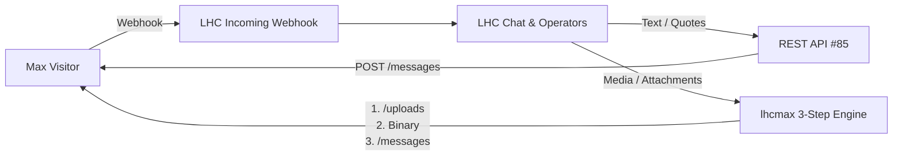

# Max Messenger Integration for Live Helper Chat (`lhcmax`)

Official standalone extension providing full two-way integration between **Live Helper Chat** and **Max Messenger (`platform-api2.max.ru`)**.

---

## 🌟 Key Features

- 💬 **Two-way Realtime Messaging**: Seamless messaging between Live Helper Chat operators/bots and Max Messenger visitors.
- 📎 **Native 3-Step Media Upload Flow**: Built-in upload pipeline (`POST /uploads` &rarr; Binary Multipart Upload &rarr; `POST /messages` with attachment token) supporting:
  - 🖼️ Images (JPG, PNG, GIF, WEBP)
  - 🎵 Audio & Voice notes (MP3, OGG, WAV, M4A, AAC, OPUS)
  - 🎥 Video clips (MP4, MOV, AVI, MKV)
  - 📄 Files & Documents (PDF, DOCX, ZIP, etc.)
- 🔗 **Quotes & Reply-To Linking**: Native quote synchronization with message ID tracking (`mid`).
- ⚡ **1-Click Auto Configuration**: Built-in activator creates Incoming Webhooks and REST API templates automatically with one click.
- 🛡️ **Zero Core Modifications**: 100% independent extension. Keeps Live Helper Chat core 100% clean and fully updatable from upstream master.

---

## 🚀 Installation & Setup

### 1. Download / Clone Extension
Clone this repository into your Live Helper Chat `extension` folder:
```bash
cd /path/to/livehelperchat/lhc_web/extension
git clone https://github.com/mysubcult/lhcmax.git lhcmax
```

### 2. Enable Extension
Add `'lhcmax'` to `settings/settings.ini.php` under the `extensions` list:
```php
'extensions' => array(
    'lhcmax',
    // other extensions...
)
```

### 3. Configure in LHC Admin UI
1. Log in to Live Helper Chat admin dashboard.
2. In the left navigation menu under **Modules**, click **Max settings** (or navigate to `/index.php/site_admin/max/settings`).
3. Enter your **Bot API Token** and click **Save settings**.
4. Click **⚡ Save and Activate Max configuration** to automatically install the Incoming Webhook and REST API components.
5. Copy the generated **Callback URL** and paste it into your Max Bot Webhook configuration on the Max platform.

---

## 🏗️ Architecture Overview



---

## 📄 License
Open source under Apache-2.0 / MIT License.
